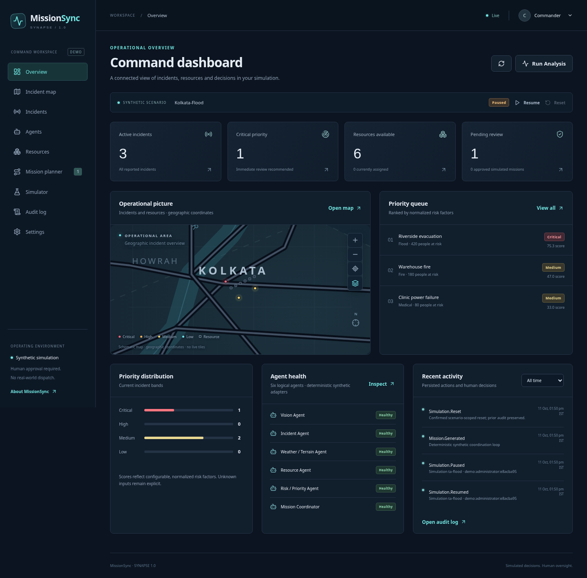

# MissionSync

A local, simulation-based emergency coordination prototype from the SYNAPSE 1.0 PRD. MissionSync maintains a shared operational picture, runs six logical analytical agents, proposes constraint-checked resource assignments, and records human review decisions.

All seeded incidents, weather, imagery assessments, resources and missions are synthetic. Approval changes simulation state only. There is no connection to dispatch systems, drones, vehicles or field equipment.



## Run locally

Requirements: Git, Python 3.12+, Node.js 24, npm, and a Linux/macOS shell (or WSL on Windows). The provided cloud environment includes these tools.

```bash
git clone https://github.com/Debayan2006/MissionSync.git
cd MissionSync
bash scripts/install.sh
bash scripts/start.sh
```

If you already have the repository, run the two scripts from its directory. Leave that terminal open, open `http://127.0.0.1:5173` in a browser on the same computer, and select **Run Live Demo** to explore the prototype. GitHub hosts the source; running these scripts starts the interactive frontend and backend.

The API runs on port 8000; Vite runs on port 5173 and proxies `/api` to the backend. Both bind to the local machine. Use the frontend's landing page to launch the dashboard or load the deterministic demonstration scenario. Stop the start script with Ctrl+C. Restarting preserves the SQLite operational state in `.local/missionsync.db`.

Loading an existing scenario preserves its incidents, inventory and weather. An administrator can restore its deterministic starting state with the confirmed Reset Scenario control; other scenarios and prior audit records are preserved.

The install script creates `.local/venv`, installs pinned Python requirements, installs the frontend lockfile, and builds the frontend. It may be rerun. Generated dependencies, caches and the local database are ignored by Git.

## Local demo roles

The local prototype simulates Viewer, Analyst, Commander and Administrator identities. Choose a role in the application. The backend issues a session token and checks permissions on mutations and decisions. An analyst cannot approve a mission; a viewer cannot mutate state. These demo identities are not production authentication.

`MISSION_SYNC_DEMO_AUTH=false` disables demo session creation. A deployed version requires a real identity provider, HTTPS, a deployment-specific authorization policy and database operational controls. Do not expose the local demo publicly.

## Development

- Frontend: `frontend/`, React and TypeScript, Vite development server.
- Backend: `backend/`, FastAPI, Pydantic validation, SQLite persistence and deterministic coordination.
- API: `/api/v1`, with generated OpenAPI documentation from FastAPI.
- Local state: `.local/missionsync.db`; override with `MISSION_SYNC_DB` for an isolated test database.
- Tests: `tests/` for API/engine validation and `e2e/` for browser workflows.
- Specification: [docs/PRD.md](docs/PRD.md).

Each cloud task is already isolated. Work in the existing checkout; create a Git worktree only if the user explicitly requests one.

## Validation

```bash
.local/venv/bin/python -m pytest tests backend/test_engine.py -q --backend-api-coverage
npm --prefix frontend run build
# With scripts/start.sh running and system Chromium installed:
.local/venv/bin/python -m pytest e2e -q
```

See [docs/validation.md](docs/validation.md) for executed checks, measured timings and known limits. Proposed accuracy/latency targets from the PRD are not automatically claims about this implementation.

`bash scripts/check.sh` builds the frontend and runs the backend and browser suites together. It starts services on temporary ports with an isolated SQLite database, then stops them and removes that test database. System Chromium is required (`CHROMIUM_PATH` can select another executable).

## Optional integrations

The core demonstration requires no external API credentials, model downloads or GPU. Vision results are explicitly simulated; report extraction and weather assessment use deterministic/synthetic inputs. External LLM/weather providers, trained image models, xBD/xView2 evaluations and real map tiles are optional integrations rather than fabricated observations. They require independent provider, licensing and model-quality validation before use.
