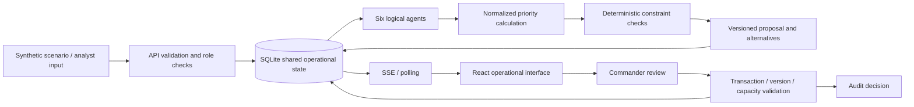

# Local prototype architecture

MissionSync keeps the core demo independent of paid providers and GPU availability. React/TypeScript renders persisted state from the versioned FastAPI API. SQLite stores entities, operational metadata, simulation events, agent runs, sessions, proposals and append-only audit records. SSE publishes committed changes; the frontend also polls as a fallback.

## Priority model

The five configurable terms use compatible normalized units. People at risk are divided by 500 people, damage severity by 10, and reported response delay by 120 minutes; each normalized value is clipped to [0, 1]. A larger response delay means greater urgency. Conflict is the fraction of required capacity that is unavailable, and friction reflects reserved eligible capacity. These are 0–1 penalties.

Default weights are 0.35 people, 0.25 damage, 0.20 response delay, −0.10 conflict and −0.10 friction. The sum of positive weights is the fixed denominator (0.80 at defaults); the final score is clipped to [0, 100]. Bands are critical ≥75, high ≥55, medium ≥30, and low below 30. The interface exposes individual contributions and confidence.

Missing measurements remain null. An unknown term is omitted from the weighted sum, reduces evidence confidence, and produces a warning. An eligible resource's declared response-time estimate may be used as an explicit planning estimate when the report provides no delay. Neither a deterministic confidence score nor a synthetic vision result is a measured ML accuracy.

## Capacity and feasibility

A resource capacity unit supports 100 people in one 60-minute simulated response window. Demand is rounded up. A resource is exclusive over overlapping half-open UTC time intervals. A plan must satisfy incident eligibility, known capacity, resource availability, weather/access conditions, required input presence, and existing reservations. Infrastructure may use a rescue resource as a documented fallback.

The planner tries simultaneous allocations and then distinct sequential schedules. Sequential alternatives expose the later start of lower-ranked incidents. Infeasible output retains its reasons and cannot be approved. Approval rechecks state versions and constraints in a database transaction; it updates only simulated assignments.

## Agent contracts and truthful sources

Vision, Incident, Weather/Terrain, Resource, Risk/Priority and Mission Coordinator are logical backend modules. Runs record structured input references, status, timestamps, output, confidence, warnings and errors. The core application does not claim live imagery or external observations. Seeded imagery assessment is synthetic, report processing is deterministic, and weather/terrain state is configured simulation data.

## Boundaries

SQLite and simulated roles are local prototype choices allowed by the PRD. Production identity, distributed workers, PostgreSQL/PostGIS, trained image inference, dataset benchmarking, external weather/LLM adapters and licensed external map tiles require separate integration work. No published environment, production deployment or real-world operational readiness is established by local checks.
